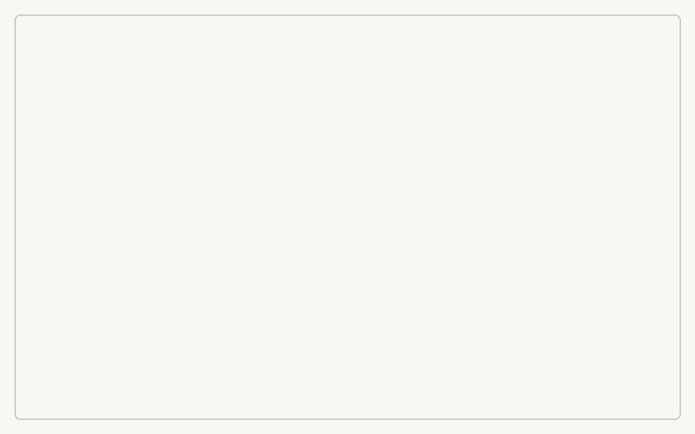

# 个人作品集网站 · 作品展示

学号：2026316010013　姓名：唐小伟

## 访问地址

- 公网 IP 访问：<http://43.136.175.239/>
- 服务器：腾讯云轻量应用服务器（Ubuntu 22.04.5 LTS，Nginx 1.18.0）
- 说明：域名 `sooyaaa.online` 已完成实名认证，但大陆服务器对外提供网站服务需要 ICP 备案，备案完成前使用公网 IP 访问。

## 仓库地址

- GitHub 仓库：<https://github.com/sooyaaaa77/sooyaaa>（公开仓库）
- 仓库包含完整源码、Markdown 文档、部署脚本与提交历史。

## 效果截图

桌面端首屏（浏览器地址栏可见服务器公网 IP）：

项目经历与个人作品区块：

> 截图要求：在电脑浏览器中打开 <http://43.136.175.239/> 后截图，**地址栏需清晰可见**；建议一张首屏、一张项目/作品区，移动端截图可作为补充。

## Git 提交记录

开发过程按 Conventional Commits 规范提交，共 28 次提交（截至 v0.4 动效版本），并打了 `v0.1.0`、`v0.2.0`、`v0.3.0` 三个版本标签：

关键提交（示例）：

| 提交 | 说明 |
| --- | --- |
| `chore: 初始化项目仓库与基础目录` | 建立仓库、目录结构与 .gitignore |
| `docs: 需求分析、技术设计与实施计划` | 三份规划文档 |
| `feat: 搭建页面骨架与首屏` | 第一版页面结构 |
| `feat: 改版为白底贴纸编辑风格（v0.3）` | 根据参考网站重构视觉 |
| `style: 增加首屏与悬停细节动效` | 分层入场、下划线绘制、吸顶导航指示块 |

> 截图要求：打开仓库的 Commits 页面截图，需能看到多次提交与提交信息；建议再截一张 `main` 分支与 tag 列表。
