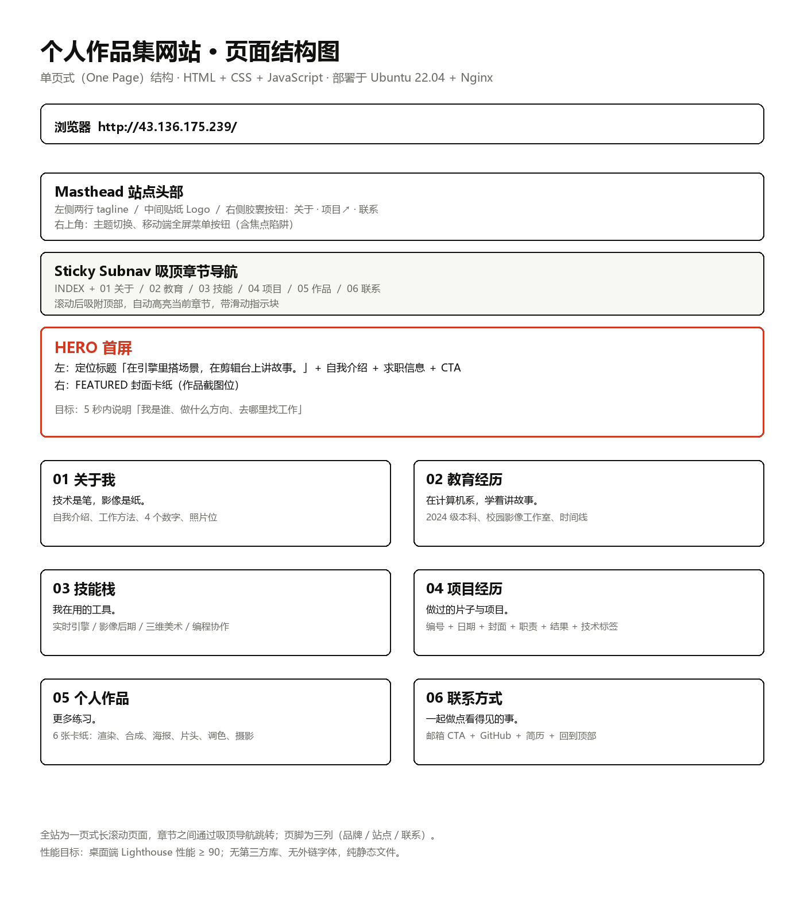

# 个人作品集网站 · 网站规划

学号：2026316010013　姓名：唐小伟

## 一、板块与内容规划

网站定位：面向 2028 届求职的**个人作品集**，一页式长滚动页面。访客主要是 HR、面试官和专业课老师，因此页面要在 5 秒内回答三个问题：**我是谁、做什么方向、去哪里找工作**。

| 区块 | 页面标题 | 内容规划 | 对求职的作用 |
| --- | --- | --- | --- |
| Hero 首屏 | 在引擎里搭场景，在剪辑台上讲故事。 | 一句话定位、两段简介、2024 级 / 求职方向 / 现居城市、主 CTA（查看项目、写封邮件）、代表作品封面卡 | 第一印象，直接说明方向 |
| 01 关于我 | 技术是笔，影像是纸。 | 自我介绍、工作方法（调研 → 分镜 → 引擎搭建 → 后期）、4 个数字（项目数、引擎时长、练习数、展映次数）、照片位 | 从「会什么」到「怎么合作」 |
| 02 教育经历 | 在计算机系，学着讲故事。 | 2024 级本科计算机专业、相关选修课、校园影像工作室后期经历、毕设方向（UE5 虚拟制片） | 说明专业背景与技术底色 |
| 03 技能栈 | 我在用的工具。 | 四组：实时引擎与虚拟制片、影像与后期、三维与美术、编程与协作 | 让面试官快速判断技能匹配度 |
| 04 项目经历 | 做过的片子与项目。 | 3 个项目：UE5 虚拟制片短片《回声》、沉浸式展项《时间切片》、纪录短片《早市》；每项含编号、日期、封面、职责、结果、技术标签 | 用作品证明能力，是核心区块 |
| 05 个人作品 | 更多练习。 | 6 张卡纸：UE5 城市街景渲染、虚拟制片合成测试、短片海报、片头动效包装、调色前后对比、校园摄影集 | 展示练习量与审美 |
| 06 联系方式 | 一起做点看得见的事。 | 邮箱（mailto）、GitHub、简历下载、回到顶部 | 降低联系成本，完成转化 |
| 页脚 | — | 三列：品牌 + OPEN TO WORK 贴纸 / 站点导航 / 社交链接；版权与课程作业说明 | 收尾与可信度 |

内容策略：

- **先真实、再丰富**。当前项目名与描述为示例，提交前必须替换成真实项目；不能编造未做过的项目。
- **每个项目写清职责**（我负责什么）与**结果**（片长、展映、成绩、播放量），比堆砌技术名词有效。
- **中英混排**：中文为主，标签用英文大写（如 `UE5`、`SEQUENCER`、`DAVINCI`），保持编辑感。
- **移动端优先检查**：HR 常在手机上点开链接，手机端必须单列、字号可读、邮箱可一键唤起。

## 二、页面结构图

结构说明：

1. **Masthead 站点头部**：左侧两行 tagline，中间贴纸 Logo，右侧三个胶囊按钮（关于 / 项目↗ / 联系），右上角为主题切换和移动端菜单。
2. **Sticky Subnav 吸顶导航**：`INDEX` 加 01–06 六个章节，滚动时吸附在顶部，自动高亮当前章节，并用滑动黑色胶囊指示位置。
3. **HERO 首屏**：双栏布局，左侧文字，右侧封面卡纸；主标题两行，第二行结尾用红色手绘下划线强调。
4. **六个内容区块**：01 关于我、02 教育经历、03 技能栈、04 项目经历、05 个人作品、06 联系方式。
5. **页脚**：品牌、站点导航、社交链接三列。
6. **补充页面**：404 页面沿用同一套贴纸语言，提供「回到首页」和「发邮件」两个出口。

技术形态：纯静态 `HTML + CSS + JavaScript`，无构建步骤、无第三方库、无外链字体，Nginx 直接托管静态文件。

## 三、风格与配色

### 3.1 设计参考与关键词

参考 [The Pudding](https://pudding.cool/) 的编辑风格：**白底、黑字、贴纸、粗框、衬线大标题**。关键词：编辑感、纸上杂志、贴纸拼贴、克制的一点红。

整体策略是「**严格黑白 + 一点红**」：

- 页面底色纯白 `#ffffff`，交替区块用暖白 `#f7f7f4`；
- 正文墨黑 `#111110`，次级文字灰 `#6b6b66`；
- 只有强调色红 `#cf3a22`，用于手绘下划线、贴纸、结果标签、悬停强调，面积不超过页面的 5%；
- 作品封面使用 6 种低饱和纸色做卡纸底，颜色只出现在封面框内，不铺满页面。

### 3.2 色板

| 用途 | 变量 | 色值 | 对比度（白底） | 说明 |
| --- | --- | --- | --- | --- |
| 页面底色 | `--paper` | `#ffffff` | — | 纯白编辑纸面 |
| 交替区块底色 | `--paper-2` | `#f7f7f4` | — | 暖白，弱分割 |
| 主文字 | `--ink` | `#111110` | 18.89:1 | 达 WCAG AAA |
| 次级文字 | `--ink-2` | `#3a3a36` | 11.42:1 | 段落与列表 |
| 辅助文字 | `--muted` | `#6b6b66` | 5.36:1 | 描述、日期、注释 |
| 描边 | `--line` | `#e4e4de` | — | 1px 分割线 |
| 强描边 | `--line-strong` | `#c9c9c2` | — | 输入框、卡纸边框 |
| 强调红 | `--accent` | `#cf3a22` | 4.90:1 | 下划线、贴纸、链接悬停 |
| 红底白字 | `--accent-solid` | `#cf3a22` | 4.90:1 | 白字压红底仍达 AA |

卡纸底色（仅作作品封面底，其上文字始终为墨黑）：

| 卡纸 | 色值 | 用途示例 |
| --- | --- | --- |
| `--mat-1` | `#f3ddd4` | 渲染 / 场景 |
| `--mat-2` | `#f2ecd6` | 合成 / 测试 |
| `--mat-3` | `#e7e3ef` | 海报 / 平面 |
| `--mat-4` | `#dee9e3` | 动效 / 包装 |
| `--mat-5` | `#f4e8dc` | 调色 |
| `--mat-6` | `#e9e9e6` | 摄影 |

暗色主题保留：底 `#121211`，文字 `#f2f1ec`，强调色提亮为 `#ff6a4d`（6.62:1），红色实底仍用 `--accent-solid` 保证白字对比度。

### 3.3 字体与字号

- 标题：衬线体栈 `Georgia, "Songti SC", "Noto Serif SC", SimSun, serif`，大字号、常规字重，模拟杂志标题；
- 正文：无衬线体栈 `Helvetica Neue, Helvetica, "PingFang SC", "Microsoft YaHei", sans-serif`；
- 标签与导航：等宽体栈 `SFMono-Regular, Menlo, Consolas, "Courier New", monospace`，全部大写、加字距；
- 字号：Hero 标题 `clamp(2.5rem, 6vw, 5.5rem)`；区块标题 `clamp(1.9rem, 3.6vw, 3rem)`；正文 17–18px；标签 11–12px；
- 不使用任何外链字体（国内访问与离线预览都稳定），只用系统字体。

### 3.4 版式与组件规格

- 栅格：内容最大宽度 1120px，左右留白 `clamp(20px, 5vw, 48px)`；区块纵向间距 `clamp(72px, 9vw, 128px)`。
- 贴纸：白底、1.5–2px 黑描边、外圈 4px 白描边、硬阴影 `2px 3px 0 rgba(17,17,16,.14)`，轻微旋转（-3° ~ 3°）。
- 卡纸：粗黑框（3px）+ 白底 + 内嵌 4:3 作品图，悬停时上浮 4px 并出现硬阴影。
- 圆角克制：按钮胶囊全圆角，卡片 10px，标签 3px，其余直角。
- 动效：只做「有意义的动效」——首屏文字分层入场、红色下划线绘制、区块进入视口时标题下划线展开、卡片悬停上浮、吸顶导航胶囊滑动；全部尊重 `prefers-reduced-motion`。

## 四、AI 辅助设计的关键提示词（节选）

1. **定风格**：「参考 pudding.cool 的编辑设计语言，做一个个人作品集首页：纯白底、黑色贴纸按钮、衬线大标题、一点红色强调；不要圆角卡片堆叠，不要紫色渐变，不要玻璃拟态。」
2. **定版式**：「一页式长滚动，顶部是站点头部 + 吸顶章节导航，首屏左文右图，下面依次是 01–06 六个区块，页脚三列；标签用等宽大写，卡片用粗黑框卡纸。」
3. **定内容**：「内容方向是 UE5 与传媒交叉：实时引擎、虚拟制片、影视后期。不要突出后端开发；项目描述写清职责和结果。」
4. **定实现**：「纯 HTML/CSS/JS，不用框架和构建工具；所有文字用系统字体；页面要能被 Nginx 直接托管；注意键盘可访问性和 reduced-motion。」

> 说明：以上提示词来自实际开发过程，完整版本记录在项目仓库 `docs/06-ai-usage.md`。
